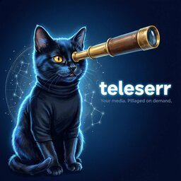
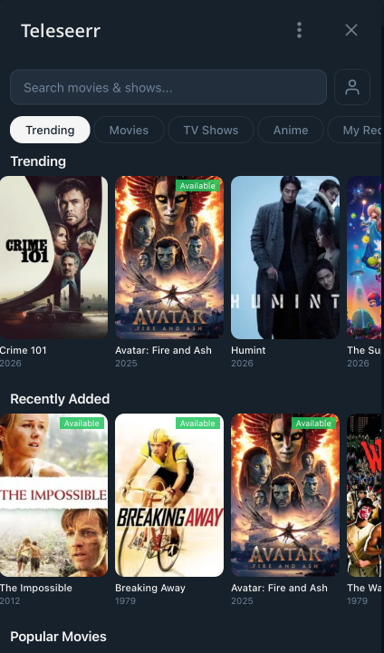
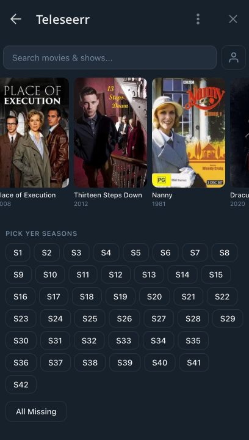
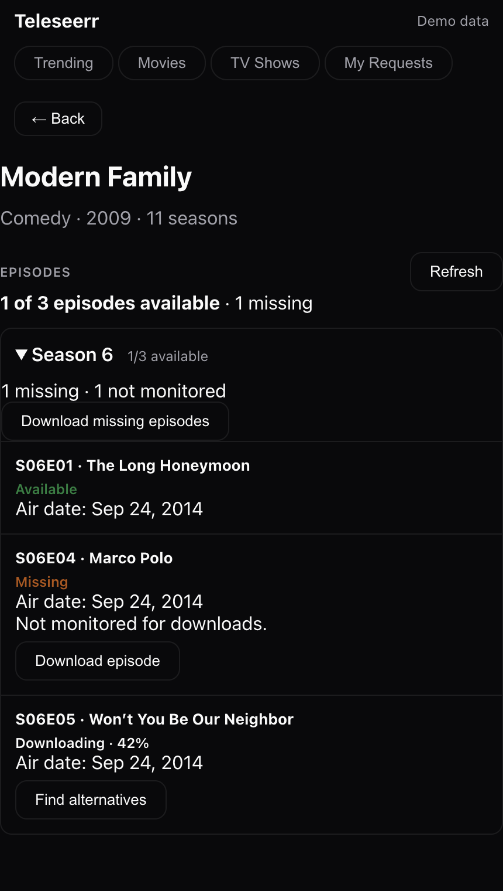
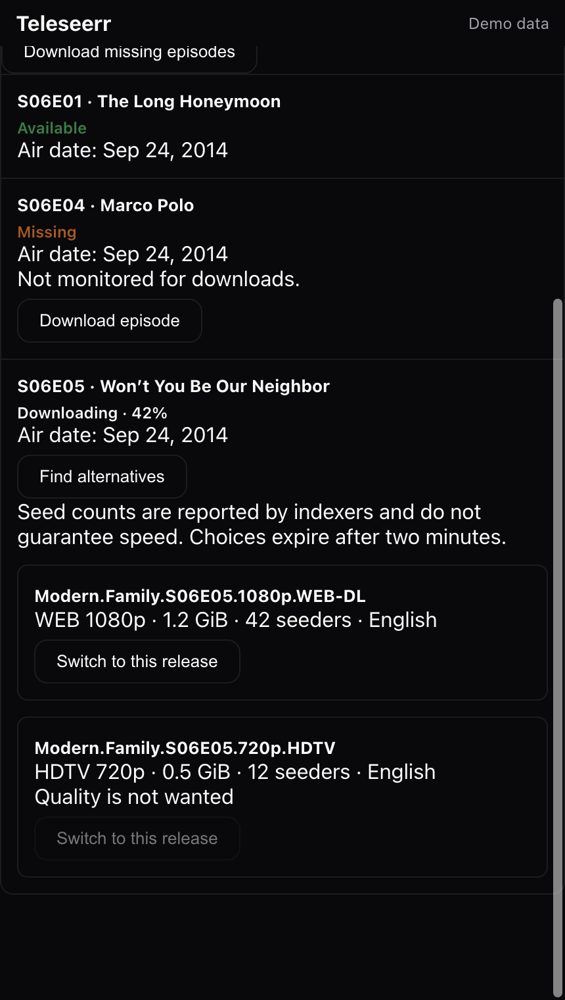

# Teleseerr

**Find it. Request it. Fix a stuck download. All inside Telegram.**

A Telegram bot and Mini App for your [Seerr](https://github.com/seerr-team/seerr)
(or Jellyseerr/Overseerr) library. Browse movies, TV and anime, pick what to watch,
and get a message when it’s ready.

 

  
  

## What Teleseerr adds

Seerr handles the library requests. Teleseerr brings the experience into Telegram
and adds controls for when a download needs help.

- **Request without leaving the chat.** Open the Mini App from your bot, browse,
  search and request with your linked Seerr account.
- **See what’s actually happening.** Episode availability and download progress
  sit alongside the title, so “approved” doesn’t have to mean guessing.
- **Recover one episode or a season.** Download a missing aired episode, or search
  for all missing episodes in a season—even if they stopped being monitored.
- **Choose another release.** Compare quality, size, language and reported seeders
  when a transfer gets stuck. Ineligible choices explain why they’re blocked.
- **Solve playback problems.** **Having trouble?** shows file languages, download health, your active Plex playback, and cleanup dates. Send a report and track it until it works.
- **Replace a bad copy.** Choose a different episode, movie, or complete-season release while the current files stay available during downloading.
- **Change your mind.** Edit or cancel your own pending requests, request the latest unrequested season, or retry a failed request.
- **Let trusted users help themselves.** An admin can grant download-management
  access without handing out Sonarr or Radarr access.

Already using Seerr’s Telegram notifications? Keep that familiar idea, and add
browsing, requesting and download recovery in the same Telegram app.

## Missing episode? Stuck download?

Open the show’s **Seasons & episodes** section. Choose **Download episode** for one missing
episode, **Download missing episodes** for the season, or **Find alternatives**
for an existing transfer.

  
  

*Recovery screenshots use demo data rendered by the real UI. These actions need
an admin’s **Manage downloads** permission and configured Sonarr/Radarr services.*

Episode recovery works for shows already in Sonarr. It searches only the selected
missing aired episodes; normal automatic cleanup still applies. A search starts
the process—**Available** means the episode has reached the library.

## Won’t play? Wrong audio?

Open a title or episode and tap **Having trouble?**. Check the file’s tracks and download state, find another release, or send a report with your device and error. Find your reports under **Requests → Problems**; tap **Works now** after testing playback.

Download changes need **Manage downloads**, granted by your admin in **People**. Reports and pending-request changes are available to linked users. Optional integrations provide cleanup and Plex details; unavailable services are labelled clearly.

## Get started

1. Open your server’s Teleseerr bot in Telegram and tap the Mini App button.
2. If you’re new, wait for the admin to link your account.
3. Find a title, request a movie or choose TV seasons, and follow **My Requests**.

With notifications configured, the bot messages you when a request is approved,
available or declined. Normal requests follow your Seerr quotas and approval
rules. Single-episode recovery is a separate download-management action.

**Hosting your own?** See the [setup guide](docs/setup.md) for Docker, configuration
and integrations. Teleseerr needs an existing Seerr instance and a Telegram bot.
